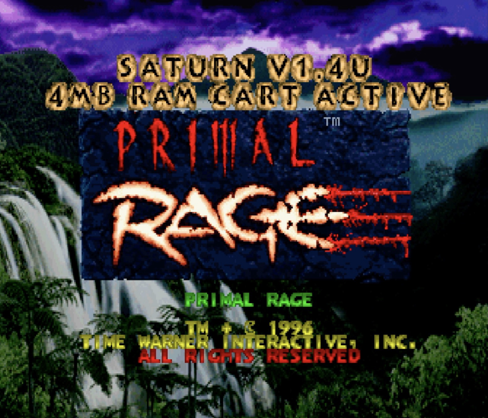

### How to apply

* Download `Primal_Rage_4MB_Patcher.html` and open it in a browser
* Drop `Primal Rage (USA) (Track 01).bin` into it
* Pick your patch (I always use Default)
* Save and replace (Keep your original!)

Older patches (they're IPs patches) provided for posterity's sake.

### Changelog

Primal Rage (USA, Saturn): 4MB RAM Cart Full-Animation Hack

v0.8

Fixed the garbage in the leftmost 8 pixels of the title screen. It showed up after skipping a demo with Start, or after a demo that skips the score screen. That column is now cleared as the title fades in.

v0.7

Fixed the score screen after a cart match: the animated fighter was missing and the game crashed. Image numbering now rewinds properly when later screens load their graphics.
Gave the cart-match image-record area more room.

v0.6

Fixed the attract and arcade mode hang on real hardware. The extra graphics those modes load after a match had no room left. Player 2’s set now uses two 1MB areas of the cart, and the leftover cart space is shared with the game.
The patch now only reserves 1KB of Work RAM instead of 2KB.

v0.5

The Time Warner and Probe logo movies can now be skipped with Start, like the intro movie.

v0.4

Fixed the black-screen hang on the first cart load on a real Saturn. Loading into the cart now uses the game’s own CPU copy instead of the DMA transfer mode, because DMA can’t write to the cart. The MiSTer core allowed it, which is why the bug didn’t show there.

v0.3

Fixed hitboxes in cart matches: both fighters now load the full-set hitbox tables that match their full animation sets.
Fixed the garbage on the LOADING and title screens after a cart match. Player 2’s images no longer overwrite the front-end graphics.

v0.2

Added the “4MB RAM CART ACTIVE” line on the title screen when a 4MB cart is detected.

v0.1

First release. With a 4MB RAM cart, normal (non-mirror) matches load the full mirror-match animation set for both fighters, with player 2’s set in the cart.
Without a cart, with a 1MB cart, or in mirror and clone matches, the game behaves exactly like the original.
